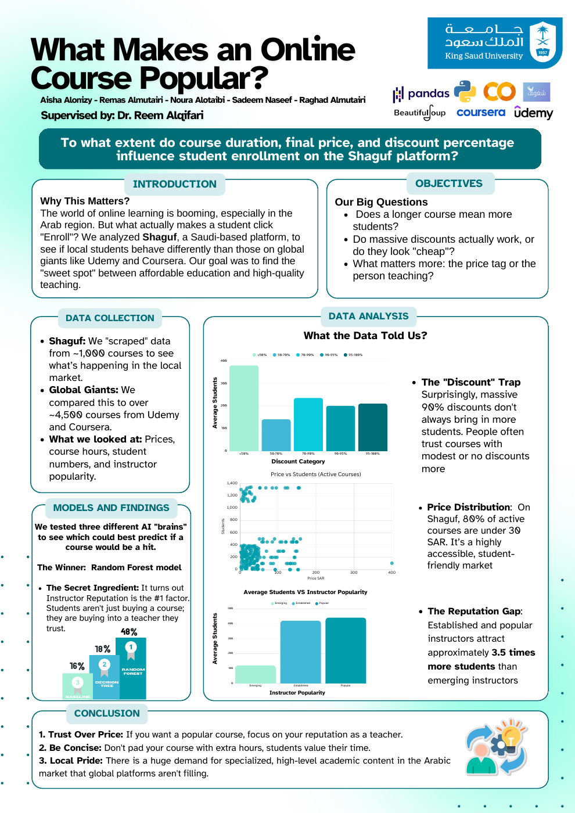

# What Makes an Online Course Popular?

A data science project analyzing the factors that drive student enrollment in online courses, comparing **Shaguf** (a Saudi e-learning platform) with **Udemy**. Built for *IT362: Data Science* at King Saud University.

**Research question:** To what extent do course duration, final price, and discount percentage influence student enrollment?



## Data

| Dataset | Source | Size |
|---|---|---|
| `shaguf_courses_cleaned.csv` | Web-scraped from Shaguf (Python, Google Colab) and cleaned | 961 courses |
| `udemy_courses.csv` | [Kaggle – Udemy Courses Dataset](https://www.kaggle.com/datasets/refiaozturk/udemy-courses-dataset) | 3,678 courses |
| `combined_courses_final.csv` | Shaguf + Udemy aligned to a shared structure, used for modeling | 3,956 courses |

**Collected attributes:** number of students, duration, current and original price, discount percentage, course level, instructor, and university.

## Workflow

1. **Data collection** – scraped ~1,000 Shaguf courses with pagination handling and controlled request timing.
2. **Cleaning & feature engineering** – parsed numeric values from text, handled missing values, normalized features, and created `students_log`, `price_log`, `has_discount`, `is_free`, and instructor-popularity features.
3. **Exploratory data analysis** – examined how price, discounts, duration, and instructor reputation relate to enrollment.
4. **Modeling** – trained three regression models to predict `students_log` (80/20 train-test split).
5. **Evaluation** – compared models using MAE, RMSE, and R².

## Results

| Model | MAE | RMSE | R² |
|---|---|---|---|
| Linear Regression (baseline) | 1.66 | 2.05 | 0.16 |
| Decision Tree (`max_depth=5`) | 1.62 | 2.02 | 0.18 |
| **Random Forest** (`n_estimators=200`, `max_depth=6`) | 1.79 | 2.22 | **0.48** |

Random Forest was selected as the final model because it explained the most variance in enrollment (R² = 0.48), roughly three times the baseline.

*MAE and RMSE are on the log-transformed scale of student counts.*

## Key Findings

- **Instructor reputation matters most:** established and popular instructors attract about **3.5× more students** than emerging ones.
- **Heavy discounts don't guarantee enrollment:** courses with discounts above 50–60% did not attract more students; modest or no discounts often performed better.
- **Duration is a neutral factor:** no clear relationship between course length and enrollment.
- **Shaguf is an affordable market:** about 80% of active courses cost under 30 SAR.

## Code

| File | Description |
|---|---|
| `00_web_scraping.py` | Scrapes Shaguf listing and course pages (pagination, throttled requests, regex parsing of Arabic/English text) and fills in missing student counts |
| `01_data_alignment_and_baseline_model.ipynb` | Aligns Udemy with Shaguf's structure, builds the combined dataset, and trains the Linear Regression baseline |
| `02_random_forest.ipynb` | Random Forest model with feature importance and residual analysis |
| `03_decision_tree.ipynb` | Decision Tree model and feature importance |
| `04_model_comparison.ipynb` | Side-by-side comparison and final model selection |

## How to Run

```bash
pip install pandas numpy scikit-learn matplotlib seaborn requests beautifulsoup4 lxml
jupyter notebook
```

Keep the CSV files in the same folder as the notebooks, then run them in order.

## Tools

Python · Pandas · NumPy · Scikit-learn · Matplotlib · BeautifulSoup · Google Colab

## Team

Aisha Alonizy · Remas Almutairi · Noura Alotaibi · Sadeem Naseef · Raghad Almutairi

Supervised by Dr. Reem Alqifari.
